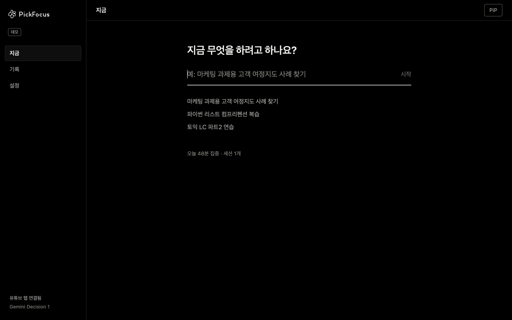
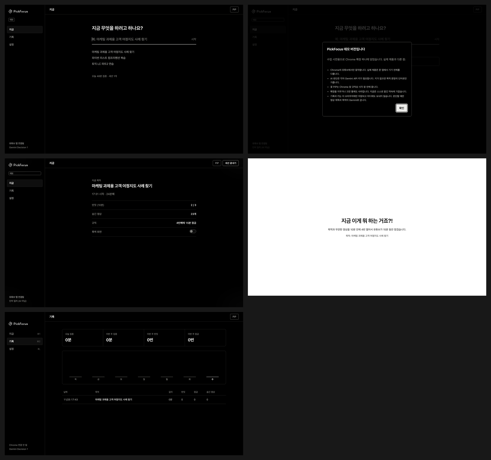

# PickFocus — 하나에만 집중!

**목적을 써야 유튜브가 열리고, 목적에 맞는 영상만 남는 집중 도구**

유튜브에 과제 자료 하나 찾으러 들어갔다가 추천 영상에 한 시간을 쓴 적, 다들 있죠. PickFocus는 내가 쓴 목적 한 문장을 기준으로 유튜브에서 그 목적에 맞는 영상만 남기고 나머지는 원래 없던 것처럼 지웁니다. 앱이 나를 통제하지만, 그 규칙은 시작할 때 내가 고른 것입니다.

## 주요 기능

**1. 목적을 써야 열리는 유튜브**
목적을 쓰지 않으면 유튜브 화면이 열리지 않습니다. "마케팅 과제용 고객 여정지도 사례 찾기"처럼 지금 할 일을 한 문장으로 쓰면 그때부터 유튜브를 쓸 수 있습니다.

**2. 목적에 맞는 영상만 남기기**
홈, 검색, 구독, 추천 어디서든 AI(Gemini Decision 1)가 영상 제목을 보고 목적과 맞는지 판단합니다. 맞지 않는 영상은 빈칸도 남기지 않고 사라지고, 쇼츠 피드와 끝화면 추천도 숨깁니다. 검색은 언제든 할 수 있습니다.

**3. 딴짓하면 꽃잎이 떨어지는 PiP**
작은 꽃 창을 화면에 띄워 둘 수 있습니다. 목적과 무관한 영상을 열 때마다 꽃잎이 하나씩 떨어져서, 지금 얼마나 흐트러졌는지 한눈에 보입니다.

**4. 반복하면 15분 잠금**
10분 안에 무관한 영상을 3번 열면 경고하고, 4번째에는 흰 화면에 "지금 이게 뭐 하는 거죠?!"가 뜨며 유튜브가 15분 동안 잠깁니다. 목적을 바꿔 써도 풀리지 않습니다. 부담스러우면 시작 전에 "경고만"으로 고를 수 있습니다.

**5. 집중 기록**
오늘과 이번 주 집중 시간, 딴짓 횟수, 잠금 횟수, 숨긴 영상 수를 기록 화면에서 볼 수 있습니다. 점수나 연속 기록 없이 사실만 보여 줍니다.

## 설치 (Windows · Mac 같음, Chrome 필요)

1. 이 페이지 위쪽의 초록색 **Code** 버튼 → **Download ZIP**을 눌러 받고 압축을 풉니다.
2. Chrome 주소창에 `chrome://extensions`를 입력합니다.
3. 오른쪽 위 **개발자 모드**를 켭니다.
4. **압축해제된 확장 프로그램을 로드합니다**를 누르고, 압축을 푼 폴더 안의 **`extension`** 폴더를 고릅니다.
5. PickFocus 화면이 열리면 목적을 쓰고 유튜브를 열어 보세요. 다음부터는 툴바의 꽃 아이콘(퍼즐 아이콘에서 고정)으로 엽니다.

## 데모 안내: 왜 Chrome 확장인가요?

PickFocus가 원래 그리는 모습은 **목적을 써야 폰과 컴퓨터를 쓸 수 있는 앱**입니다. 폰 앱에서는 목적을 정하기 전까지 앱이 잠기고, 앱 종류마다 다른 규칙(유튜브는 목적에 맞는 영상만, 쇼츠는 닫힘, 음악은 허용)을 적용하는 것이 목표입니다.

이번 데모는 그 핵심인 **목적 → 맞는 것만 남기기 → 딴짓하면 잠금** 흐름을 가장 빨리, 누구나 직접 써 볼 수 있게 확인하려고 만들었습니다. 그래서 딴짓이 가장 많이 일어나는 유튜브 하나에 집중했고, Windows·Mac 어디서나 설치되는 Chrome 확장으로 만들었습니다.

수업(단국대학교 진로와창업설계) 시연용이라 지금은 이런 한계가 있습니다.

- Chrome의 유튜브에서만 동작합니다. 실제 제품은 폰 앱에서 기기 전체를 다루는 것을 목표로 합니다.
- 쓰는 사람이 몰리면 영상 판단이 잠시 늦어지거나 멈출 수 있습니다.
- 꽃 PiP는 Chrome 규칙상 작은 사각 창 안에 뜹니다.
- 확장을 끄거나 지우면 통제도 사라집니다. 지금은 스스로 맡긴 약속에 가깝습니다.

## 개인정보

- 판단할 때 보내는 것: 내가 쓴 목적과 화면에 보이는 영상 제목·검색어.
- 보내지 않는 것: 시청 기록, 영상 설명, 댓글, 계정 정보.
- 기록과 설정은 내 브라우저에만 저장됩니다.

